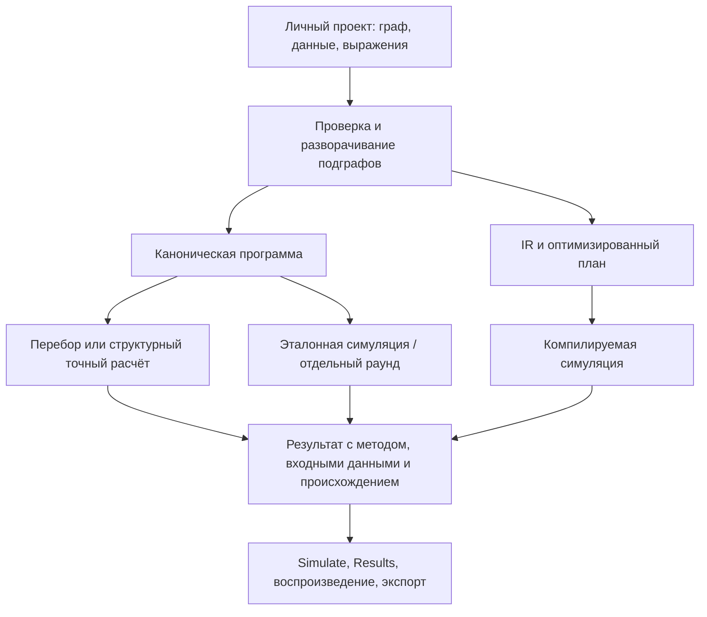

# Slot Math Lab: устройство и реализованные возможности

Это описание реализации в ветке `task/modern-primitives-compiler`. Основание —
исходники пяти .NET-проектов, фронтенда, генераторов, инфраструктуры и тестов.
Здесь описаны доступные механизмы и их ограничения. Наличие тестового сценария
показывает, что именно проверяется; результат проверки конкретной сборки нужно
смотреть в её CI или локальном запуске.

## Содержание

- [Назначение и состав](#overview)
- [Запуск](#startup)
- [Личные проекты и сохранение](#projects)
- [Редакторы модели](#editors)
- [Граф, выражения и числа](#graph)
- [Компилятор и оптимизации](#compiler)
- [Точные расчёты и симуляция](#evaluation)
- [Дополнительная математическая библиотека](#math-library)
- [Игры и переиспользуемые механики](#games)
- [Измерения и проверка результатов](#measurements)
- [Архив, воспроизведение и экспорт](#results)
- [Связь с сервером и хранение](#persistence)
- [API, доступ и дополнительные функции](#api)
- [Развёртывание](#deployment)
- [Тесты, генерация и производительность](#testing)
- [Границы реализации](#limits)

<a id="overview"></a>
## 1. Назначение и состав системы

Slot Math Lab позволяет задать случайную модель игры в виде графа, редактировать
её данные и механику, исполнить отдельный раунд, получить математический расчёт,
провести Монте-Карло и сохранить проверяемые результаты. В этой ветке реализованы
не только игровой пример и расчётный движок, но и рабочее пространство для
нескольких приватных проектов пользователя.

| Часть | Что реализовано | Основной код |
| --- | --- | --- |
| Математическое ядро | Рациональные числа, случайные источники, интерпретаторы, распределения, структурный решатель | [SlotMath.Core](../backend/SlotMath.Core) |
| Компилятор | Проверка модели, разворачивание подграфов, IR, Memory SSA, план симуляции и генерация исполняемых выражений | [Compiler](../backend/SlotMath.Core/Compiler) |
| Прикладной сервер | Конфигурации и версии, расчёты, фоновые запуски, диагностика и SignalR | [SlotMath.Api](../backend/SlotMath.Api) |
| Конструктор | Проекты, граф, редакторы источников/выплат и машин состояний | [pages](../frontend/src/pages), [authoring](../frontend/src/lib/authoring) |
| Анализ | Измерения, профили проверки, точные законы, сравнение и архив | [Measurements](../backend/SlotMath.Core/Measurements), [simulate](../frontend/src/components/simulate) |
| Игровое представление | Reference Nine Lives, отладчик и отдельная страница пяти перенесённых игр | [games](../frontend/src/games), [games.html](../frontend/games.html) |
| Проверки | Математические оракулы, сравнение исполнителей, API, логика UI и браузерные сценарии | [Core.Tests](../backend/SlotMath.Core.Tests), [Api.Tests](../backend/SlotMath.Api.Tests), [unit](../frontend/unit), [e2e](../frontend/e2e) |

Backend использует .NET 10, ASP.NET Core, EF Core/Npgsql, Hangfire, SignalR и
OpenTelemetry. Frontend — React 19, TypeScript, Vite, React Flow, Zustand и
TanStack Query. Игровая страница дополнительно использует PixiJS, GSAP и звук.
XLSX-обмен реализован через SheetJS. Python используется в независимых проверках.

Один авторский граф проходит несколько представлений:



Математическая модель и оформление игры разделены. Рисование барабанов,
анимация выигрыша и локальный демонстрационный баланс не заменяют расчёт графа.

<a id="startup"></a>
## 2. Запуск из исходников

Нужны .NET 10 SDK, Node.js 22, npm и Docker Compose. Для Python-проверок нужен
Python 3. Команды ниже выполняются из корня репозитория.

```sh
docker compose up -d postgres redis
dotnet build backend/SlotMathLab.slnx
npm --prefix frontend ci --legacy-peer-deps
```

В первом терминале запустить API:

```sh
ConnectionStrings__DefaultConnection='Host=localhost;Port=5433;Database=slotmath;Username=slotmath;Password=slotmath' \
  dotnet run --project backend/SlotMath.Api --launch-profile http
```

Во втором — frontend:

```sh
npm --prefix frontend run dev
```

API использует `http://localhost:5152`. Vite выводит свой адрес в терминал,
обычно `http://localhost:5173`. Прокси передаёт `/api`, `/hubs` и `/openapi`
на API; адрес можно изменить переменной `SLOT_MATH_API_URL` перед запуском Vite.

Важная особенность конфигурации: [docker-compose.yml](../docker-compose.yml)
публикует PostgreSQL на **5433**, Redis на **6380**. Файл
[appsettings.Development.json](../backend/SlotMath.Api/appsettings.Development.json)
задаёт PostgreSQL на 5432, поэтому для указанного Docker-запуска строка подключения
передаётся явно. Redis-кэш включается при наличии `ConnectionStrings__Redis`,
например `localhost:6380`; без него используется память процесса.

Полный локальный стек можно собрать командой `docker compose up -d --build`:
frontend будет на порту 5199, API — 5152. В Compose также описаны Prometheus
и Grafana. Для запуска нескольких рабочих копий нужны отдельные порты и тома.

<a id="projects"></a>
## 3. Приватные проекты и жизненный цикл данных

Стартовая страница — **My projects** (`/projects`). Новый workspace не выбирает
игру автоматически. Можно создать пустой проект, взять копию шаблона,
импортировать собственный JSON, открыть черновик или сохранённую серверную версию.

Проекты можно искать, переименовывать, дублировать и переключать. Каждая копия
имеет независимое редактируемое состояние; шаблон не становится общим изменяемым
объектом. При переключении сохраняется и контекст открытого вложенного графа.

В системе различаются три идентичности:

| Идентичность | Для чего нужна |
| --- | --- |
| Пользователь | Определяет доступ к конфигурациям, запускам, экспериментам и данным браузера |
| Редактируемый проект | Определяет текущий черновик, открытый подграф и настройки редакторов |
| Оценённая конфигурация | Фиксирует версию, хеш модели, исходные данные и правила конкретного расчёта |

Браузерные ключи хранилища привязаны к подтверждённому сервером пользователю.
Загрузка сохранённых stores происходит после проверки сессии. На сервере записи
имеют `OwnerId`; фильтрация применяется к чтению и изменениям, включая архив
и realtime-подписку. Фоновая задача исполняет закреплённую запись её владельца,
а SignalR использует principal своего соединения.

Черновики автоматически сохраняются **локально в браузере**. Сохранение версии
на сервере — отдельное действие. Полноценная автоматическая синхронизация
черновиков между устройствами не реализована. Локальный анонимный режим использует
общий для этого браузера контекст; он не заменяет production-аутентификацию.

Проект можно экспортировать как `slotmath-project-v1`: граф плюс метаданные
представлений. Сохраняется совместимость с обычным GraphConfig JSON.
Служебный формат editable draft дополнительно позволяет восстановить контекст
редактирования. Неизвестный формат и некорректные числа отклоняются при импорте.

Исходники: [Projects.tsx](../frontend/src/pages/Projects.tsx),
[store](../frontend/src/store/index.ts),
[browserIdentity.ts](../frontend/src/lib/browserIdentity.ts),
[projectEnvelope.ts](../frontend/src/lib/authoring/projectEnvelope.ts),
[RequestOwnership.cs](../backend/SlotMath.Api/Infrastructure/RequestOwnership.cs).
Изоляцию проверяют [PrivateWorkspaceTests](../backend/SlotMath.Api.Tests/PrivateWorkspaceTests.cs)
и [private-projects.spec.ts](../frontend/e2e/private-projects.spec.ts).

<a id="editors"></a>
## 4. Рабочие экраны и редакторы модели

Навигация определена в [App.tsx](../frontend/src/App.tsx):

| Маршрут | Назначение |
| --- | --- |
| `/projects` | Личная библиотека и создание проектов |
| `/overview` | Сводка выбранной модели и доступных свидетельств |
| `/build` | Граф, узлы, соединения и вложенные механики |
| `/model/data` | Исходные данные модели |
| `/model/features` | Механики и их использование |
| `/model/studio` | Reel / Paytable Studio |
| `/model/machine` | State Machine Designer |
| `/simulate` | Запуск и наблюдение за симуляцией |
| `/results` | Архив, расчёты, сравнение и экспорт результатов |
| `/debug` | Исполнение и просмотр трассы модели |
| `/play` | Игровое представление reference-модели |
| `/export` | Экспорт модели и базового отчёта |

Экраны работают с выбранным проектом. Nine Lives — один из примеров;
геометрия, символы и доступные операции берутся из выбранной модели.

### Граф и вложенные механики

Build предоставляет canvas React Flow, палитру, инспектор, таблицы и просмотр AST.
Можно добавлять/соединять/удалять узлы, менять параметры, открывать библиотечный
подграф, изменять его и возвращаться к родителю. Поддержаны поиск узла,
проверка соединений, сообщения компилятора и сохранение локального черновика.
Общий payload строится из актуального корневого проекта, включая вложенные правки.

### Reel / Paytable Studio

Studio строит индекс реальных источников и потребителей внутри авторского графа.
Он связывает редактируемые таблицы с конкретными узлами, выражениями и механиками.

Реализованы редакторы весов, барабанных полос, ячеечных источников, символов,
paylines, линейных и cluster-выплат, призов и связанных денежных величин.
Поддержаны создание и копирование источников, их привязка к выбранному месту
графа, жизненный цикл символов, анализ зависимостей и пересчёт связанных данных
в рамках поддержанного преобразования.

Таблицы можно копировать и импортировать в CSV, TSV и XLSX. Импорт позволяет
выбрать лист, строку заголовка, соответствие столбцов, символы по ID/имени и
единицы суммы; сначала строится preview, затем выполняется проверка и применение.
XLSX-экспорт записывает ячейки текстом, сохраняя написание ID, дробей и сумм.

Изменение выполняется транзакционно: создаётся отдельный кандидат, проверяется
текущий проект/владелец/исходный revision, затем кандидат валидируется backend.
Устаревший асинхронный ответ не должен примениться в другом проекте. Есть
отмена последней целой применённой правки в текущей browser-сессии.

Studio не редактирует произвольный JSON по догадке. Неоднозначная связь,
неподдержанный источник или непроверяемая зависимость дают явное ограничение.
Изменение геометрии существующего потребителя не подразумевается автоматически.

Код: [ReelPaytableStudio.tsx](../frontend/src/pages/ReelPaytableStudio.tsx),
[sourceIndex.ts](../frontend/src/lib/authoring/sourceIndex.ts),
[sourceLifecycle.ts](../frontend/src/lib/authoring/sourceLifecycle.ts),
[transactions.ts](../frontend/src/lib/authoring/transactions.ts),
[StudioTableImport.tsx](../frontend/src/components/authoring/StudioTableImport.tsx).

### State Machine Designer

Designer описывает состояния, переменные private/shared, действия присваивания,
случайные Draw и вызовы Library, переходы с guard-выражениями, лимит выполнения
и результат. Его собственный Machine IR преобразуется в обычные узлы, выражения
и подграфы модели. Исполнение остаётся у общего компилятора.

Есть создание и редактирование машины, подключение к графу, работа с параметрами
операций, проверка совместимости, сохранение промежуточных правок и восстановление.
Для поддержанных импортированных структур доступны привязки к исходному графу.
Если исходная структура не доказана или изменилась, Designer сохраняет исходный
AST и сообщает о конфликте вместо выдумывания преобразования.

Расположение и визуальные метаданные хранятся отдельно от математической модели.
После применения проверяются сохранность вложенного контекста и актуальность
исходника; профиль новых выплат и cap требуют согласованного изменения.

Код: [StateMachineDesigner.tsx](../frontend/src/pages/StateMachineDesigner.tsx),
[machineIR.ts](../frontend/src/lib/authoring/machineIR.ts),
[machineLowering.ts](../frontend/src/lib/authoring/machineLowering.ts),
[machineLifecycle.ts](../frontend/src/lib/authoring/machineLifecycle.ts).

<a id="graph"></a>
## 5. Граф и источники случайности

[GraphConfig](../backend/SlotMath.Core/Model/GraphConfig.cs) содержит версию схемы,
таблицы символов/выплат/линий/барабанов, распределения, начальное состояние,
узлы и рёбра, именованные выражения, пользовательские механики и внешние inputs.

Поддерживаются следующие узлы:

| Узел | Поведение |
| --- | --- |
| `draw` | Один случайный исход: inline-веса, переиспользуемое распределение или поддержанный источник весов |
| `drawMany` | Упорядоченная серия категориальных draws с записью однородного массива |
| `getState`, `putState`, `modifyState` | Чтение и изменение пользовательского состояния |
| `branch` | Выбор продолжения по условию |
| `loop` | Ограниченное повторение с условием остановки и причиной выхода |
| `map` | Поддержанный transform/evaluator, в том числе совместимые legacy-контракты |
| `library` | Вызов именованной переиспользуемой механики |
| `data` | Ввод массива данных в состояние |
| `metricsSink` | Итоговая выплата, денежное округление и cap |

Подграфы разворачиваются с переименованием внутренних идентификаторов.
Проверяются ссылки, циклы, типы, выражения, ограничения Loop и наличие
Metrics Sink. Модель состояния выводится из фактических данных и записывающих узлов.

`DistributionAsset` отделяет данные закона от Draw. Распределения разрешаются
компилятором; доступны связанные источники и выражения выбора/весов.
`drawMany` имеет ограниченный размер и сохраняет порядок случайных обращений.
У него есть эталонное и компилируемое исполнение.

Стандартный каталог загружает JSON-механики как embedded resources;
пользовательские определения могут их переопределять. В коде остаются совместимые
Map/реестры evaluators и transforms. Новые механики по правилам репозитория
составляются из общих атомов и выражений в редактируемых JSON-подграфах.

Код: [Graph.cs](../backend/SlotMath.Core/Model/Graph.cs),
[DistributionAsset.cs](../backend/SlotMath.Core/Model/DistributionAsset.cs),
[DistributionResolver.cs](../backend/SlotMath.Core/Compiler/DistributionResolver.cs),
[SubgraphInliner.cs](../backend/SlotMath.Core/Compiler/SubgraphInliner.cs).

<a id="expressions"></a>
## 6. Выражения и ограниченные операции над коллекциями

Авторская математика хранится в типизированном AST. Текстовый редактор покрывает
подмножество синтаксиса; структурный редактор сохраняет более сложные выражения.

| Группа | Реализованные операции |
| --- | --- |
| Скалярные | Константы, доступ к полю/индексу, арифметика, сравнения, Boolean, условие, числовые функции |
| Коллекции | sum/product/count/min/max, map/filter/fold с переменной элемента и индексом |
| Ограниченная композиция | Массив как Source, явный MaxItems, вложенные операции при проверенных границах |
| fold while | Условие до чтения следующего элемента; при остановке остаток массива не вычисляется |
| Лексические значения | let/local, записи, кортежи, project; локальные bindings не записывают recurrence state |
| Bitset | union/intersect/except/shift/count/first для точных масок позиций 0–63 |
| reachable | Направленная достижимость в явно ограниченном графе до 64 вершин |
| scan | Inclusive/exclusive prefix sum целых чисел или Boolean |
| segmentedCompact | Стабильное размещение сохранённых элементов в явных сегментах, исходные индексы и свободные места |
| scatter | Индексные обновления с отказом при дублях, last-write-wins или точной суммой |
| partitionIndices | Стабильная группировка исходных индексов по ограниченным плотным меткам |

Для композиционных коллекций указываются границы размера; стандартный предел
`MaxItems` — до 4096. Legacy-формы с одним StateKey сохраняют свои ограничения,
поэтому наличие map/fold само по себе не разрешает произвольную вложенность.

Ошибки арности, типов, отсутствующего поля, неверного индекса и бюджетов
передаются как диагностические ошибки. Деление на ноль не заменяется нулём.
Пустые sum/count равны 0, product — 1, fold сохраняет seed; пустые min/max —
ошибка. Фильтр требует Boolean. Дробный индекс не округляется к другому элементу.

Повторение коллекции в UI преобразуется в поддержанные общие операции и
ограниченное управление графом. `ConditionalProductComposer` строит условное
произведение как обычную композицию графа; это отдельная authoring-возможность.

Код: [Expression.cs](../backend/SlotMath.Core/Model/Expression.cs),
[Expressions](../backend/SlotMath.Core/Expressions),
[ConditionalProductComposer.cs](../backend/SlotMath.Core/Authoring/ConditionalProductComposer.cs),
[collectionRepeat.ts](../frontend/src/lib/authoring/collectionRepeat.ts).

<a id="numbers"></a>
## 7. Числа, денежные единицы и RNG

`Rational` хранит сокращённые BigInteger-числитель и положительный знаменатель;
канонический ноль — `0/1`. Числа в AST задаются строками, включая дроби.
JSON decimal/scientific initial state разбирается без предварительного округления
через double: `0.1` становится `1/10`. Для входных чисел установлены бюджеты
длины и десятичного порядка. Конечные CLR float/double сохраняют своё двоичное
значение, а decimal — десятичное.

Числовые функции сохраняют дроби. `round` использует середину от нуля,
`floor(-1/2) = -1`, `ceil(-1/2) = 0`. Явный `tonumber` проверяет текст;
ошибка преобразования не даёт неявный ноль. Записи и вложенные массивы
сохраняют типы при map/filter и записи в состояние.

Компилятор учитывает масштаб выплаты `WinScale`. Денежное округление на Sink
выполняется до WinCap; доступны floor, ceiling, nearest-even и nearest-away.
Свидетельства включают сумму до/после округления и разницу. Несовместимая
с объявленной точностью выплата отклоняется.

Общие RTP-отчёты используют средний выход модели после приведения масштаба.
Модель должна согласовать единицы с единицей ставки; в population analysis
ставка задаётся отдельно. Общий `StreamingStats.HitFrequency` считает долю
**ненулевых** исходов. Структурный решатель возвращает `P(payout > 0)`.
Для неотрицательных выплат определения совпадают; отрицательные значения
требуют проверки смысла конкретного отчёта. Прибыль сессии учитывает wager отдельно.

Генератор — `xoshiro256**` с инициализацией SplitMix64. Выбор целого диапазона
использует rejection, поток определяется seed и логическим индексом.
Alias-таблица даёт быстрый категориальный sampled draw; её пороги представлены
double. Точный закон и эта численная процедура выборки имеют разные роли.
Для конечного sampling-design реализован отдельный выбор по целым весам.

Фоновые независимые rounds разбиваются на логические потоки по 65 536 раундов.
Результаты складываются в порядке потоков независимо от worker count.
Явный `/api/evaluate/graph` использует схему с 4096 раундами; Play —
seed и round index. Эти индексы не взаимозаменяемы. Опциональный аудит сохраняет
идентичность и сведения о реально потреблённом RNG-потоке.

Код: [Rational.cs](../backend/SlotMath.Core/Math/Rational.cs),
[NumericValues.cs](../backend/SlotMath.Core/Expressions/NumericValues.cs),
[MonetarySettlement.cs](../backend/SlotMath.Core/Model/MonetarySettlement.cs),
[Random](../backend/SlotMath.Core/Random),
[OrderedChunkFold.cs](../backend/SlotMath.Core/Math/OrderedChunkFold.cs).

<a id="compiler"></a>
## 8. Компилятор, IR и оптимизированное исполнение

Вход проходит разрешение распределений и выражений, объединение механик,
проверку ссылок, разворачивание Library, вывод схемы состояния и validation.
Строится каноническая программа. Для допустимой модели дополнительно создаётся
план sampling; эталонная программа сохраняется.

В промежуточном представлении:

- Expression IR описывает типизированные операции, вложенные регионы и значения.
- Эффекты фиксируют чтение/запись состояния, RNG, наблюдение, ошибки, выделения
  и отмену. Неизвестная операция ограничивает допустимые оптимизации.
- Memory SSA отслеживает версии ресурсов и reaching definitions через
  ветвления, последовательные continuations, вызовы и циклы.
- IR-verifier и Memory-SSA-verifier проверяют внутреннюю согласованность.

Оптимизации включают распространение констант состояния, упрощение выражений,
повторное использование скаляров, отложенные записи, анализ владения коллекциями
и повторное использование подходящих буферов. Вложенные заимствованные элементы
не становятся эксклюзивным буфером только из-за выведенного типа массива.

`Precompute` позволяет описать конечные домены и ожидаемое число использований.
Таблица строится при допустимых расходах работы/памяти и проверяемых зависимостях.
При изменении предпосылок или отказе анализа сохраняется обычное вычисление.

План использует индексированные приватные state frames, подготовленные источники
случайности, отдельные runner/буферы для workers и compiled delegates.
Горячие выражения могут компилироваться через System.Linq.Expressions в код CLR.
Поддержаны режимы interpreted, compiled и tiered. Это внутренняя генерация
исполнения; самостоятельный экспорт production C#-проекта из этого механизма
не следует.

Ограничения оптимизации сохраняют ошибки, порядок вычислений/RNG, наблюдения,
отмену и итоговое состояние. Неподдержанное исполнение остаётся на общем пути.
Компилируемый cache привязан к модели и плану измерений; worker не получает
общий изменяемый state другого запуска.

Отдельно доступен **Simplify graph** (`POST /api/validate/simplify`): endpoint
проверяет исходник, строит preview с хешами/перечнем правок, сохраняет неизвестные
расширения и проверяет кандидата. Применение в проекте — отдельная транзакция;
сам preview ничего не сохраняет. Сохраняются идентичность узлов, рёбра,
порядок действий и точки наблюдений.

Код: [GraphCompiler.cs](../backend/SlotMath.Core/Compiler/GraphCompiler.cs),
[Ir](../backend/SlotMath.Core/Compiler/Ir),
[SamplingPlan.cs](../backend/SlotMath.Core/Compiler/SamplingPlan.cs),
[FinitePrecomputation.cs](../backend/SlotMath.Core/Compiler/FinitePrecomputation.cs),
[Optimization](../backend/SlotMath.Core/Optimization),
[GraphSimplificationEndpoint.cs](../backend/SlotMath.Api/Features/Validate/GraphSimplificationEndpoint.cs).

<a id="evaluation"></a>
## 9. Расчёт: перебор, структурный решатель и sampling

В `/api/evaluate/graph` выбираются Mode, необходимое Evidence и опциональный
population analysis. Реальный метод возвращается отдельно от запрошенного.

| Mode | Реализация |
| --- | --- |
| Exact | Точное вычисление через допустимую стратегию, с явным отказом при исчерпании бюджета |
| Pruned | Точный расчёт с учётом отсечённой массы и интервала |
| Sampled | Монте-Карло; возвращаются наблюдения и их статистическая неопределённость |
| Hybrid | Автоматический выбор доступного exact/structured/sampled пути; смешанный estimator по частям графа не заявляется |

### Канонический точный интерпретатор

ExactInterpreter перечисляет исходы, объединяет одинаковые результаты рационально,
мемоизирует подходящие recurrence states вместе с continuation/program point
и учитывает epsilon/ограничения. ExactEmitInterpreter отдельно поддерживает
распределение суммарного Emit и вкладов по labels.

### Структурный точный решатель

`StructuredExactEvaluator` получает модель из того же скомпилированного графа.
Он выводит зависимости случайных величин и вычисляет необходимые законы/моменты
без обязательного перечисления всех комбинаций раунда.

Поддержаны условные распределения, свёртки, структурные моменты до четвёртого
порядка, hit frequency, передача состояния через bounded loops, марковское
представление циклов и матричные способы ускорения. Для плотных целочисленных
свёрток есть точный NTT/CRT-путь с выбором по оценке стоимости.

Решатель планирует попытки в зависимости от требуемого свидетельства:
mean, moments или полного law. Optional-метрика может остаться недоступной,
даже если среднее рассчитано точно. Если cap/settlement требует полного закона,
одних моментов недостаточно. Отказы имеют причину; диагностические результаты
могут включать попытки, работу, сведения о циклах, свёртках и логическом storage.

| Evidence | Что запрашивается |
| --- | --- |
| Mean | Математическое ожидание |
| Moments | Моменты и поддержанное свидетельство hit frequency; хвосты полного закона не запрашиваются |
| Report | Полный отчёт в пределах доступных законов и бюджетов |

Частичное или отсечённое вычисление не становится полным точным законом.
`ExactInterval` содержит границы и массу потери; `ExactWithMassLoss` сохраняет
явную неограниченную потерю; `Sampled` означает оценку. Название режима не
заменяет проверку provenance, method, status и доступных полей.

### Population analysis и риск

При сохранённом полном точном законе доступны CDF, survival по порогам,
квантили, expected shortfall выплат и потерь оператора. Из точных моментов
строятся mean/variance, центральные моменты, CV², skewness², excess kurtosis
и отдельные display-значения, где нужен корень.

Есть планирование объёма независимой выборки по заданной ширине RTP —
normal-оценка и Chebyshev-граница. Для фиксированного горизонта независимых
раундов реализованы распределение суммарной потери, его хвосты и расчёт
первого отрицательного резерва. Эта модель продолжает расчёт после insolvency;
она отличается от session stop-on-ruin.

Полный закон обязателен для точных хвостов и ruin-распределения. Среднее,
sampled histogram или pruned law не дают такого свидетельства. Каждая ветвь
может отдельно вернуть `Unavailable` с причиной, не обнуляя её смысл.

Код: [EvaluationStrategies](../backend/SlotMath.Api/Features/Evaluate/EvaluationStrategies),
[Structured](../backend/SlotMath.Core/Math/Structured),
[ExactIntegerConvolution.cs](../backend/SlotMath.Core/Math/ExactIntegerConvolution.cs),
[PayoutAnalysis.cs](../backend/SlotMath.Api/Features/Evaluate/PayoutAnalysis.cs),
[IndependentRoundExposureAnalysis.cs](../backend/SlotMath.Api/Features/Evaluate/IndependentRoundExposureAnalysis.cs).

<a id="math-library"></a>
## 10. Дополнительные инструменты математического ядра

В Core реализованы также самостоятельные библиотеки для явно переданных
конечных моделей. Наличие класса в Core не означает готовую форму UI для
произвольного графа.

| Инструмент | Реализованная задача |
| --- | --- |
| ExactSparseMatrix / ExactLinearAlgebra | Рациональные разреженные операторы и ограничение вычислительной работы |
| MarkovRewardMatrix | Переходы конечной цепи с вознаграждениями и переносом моментов |
| ExactTensorOperator | Суммы tensor-product операторов, дискретные ядра, генераторы и uniformization |
| FiniteChainStructure | Достижимые состояния и communicating classes |
| ExactSurvivalCertificate | Проверяемая верхняя граница выживания и остаточной награды |
| ExactMixingCertificate | Minorization/contraction, stationary residual и спектральные границы |
| ExactOperatorExposure | Накопленная потеря оператора и first-passage ruin |
| ExactDecisionSolver | Конечногоризонтный Bellman solver по belief state, действиям и наблюдениям |
| ExactDecisionPotential | Проверка свойств переданной decision-модели |
| ExactPayoutLaw | Точный анализ полного закона выплат |

Decision solver различает авторские наблюдения и явный FullState-relaxation.
Он возвращает дерево политики с вероятностями ветвей и точными величинами,
учитывает action wagers, entry cost и горизонт. Модель должна содержать всё,
что влияет на будущее, включая финансовые ограничения. Установлены бюджеты
состояний, действий, исходов, belief/policy nodes и работы.

Эти инструменты рассчитывают предоставленную модель. Сами по себе они не
доказывают соответствие сторонней игре или автоматически выбранную независимость.

Код: [Math](../backend/SlotMath.Core/Math).
Примеры независимых проверок:
[ExactDecisionTests](../backend/SlotMath.Core.Tests/Math/ExactDecisionTests.cs),
[ExactTensorOperatorTests](../backend/SlotMath.Core.Tests/Math/ExactTensorOperatorTests.cs),
[ExactChainCertificatesTests](../backend/SlotMath.Core.Tests/Math/ExactChainCertificatesTests.cs).

<a id="games"></a>
## 11. Игровые модели и переиспользуемые механики

В My projects доступны пустая модель, reference Nine Lives, пять перенесённых
моделей и два starter-примера cluster pays/cascading clusters.

Перенесённые модели: **Ancient Dragon, Woodland Whisper, Le Militare, X7 Club
и Nine Lives**. Reference Nine Lives и вариант Nine Lives из TGslots — отдельные
шаблоны; их нельзя считать одной конфигурацией только по названию.

В `games/shared/graph` находятся генераторы обычных JSON-подграфов:
источники ячеек/барабанов, paylines и line evaluation, cluster candidates/
достижимость/выплаты, каскады и gravity/refill, scatter, column boost,
hold-and-spin, pick bonus, таблицы и упаковка значений. Получившиеся механики
можно открывать и редактировать в конструкторе.

Параметры берутся из model.json и состояния соответствующей модели.
Поле targetRTP — авторская цель; её наличие не доказывает фактический RTP.
Численные заявления нужно связывать с конкретным хешем, методом и результатом.

Игровой UI существует в двух формах:

- `/debug` исполняет выбранную модель через общий API, позволяет закрепить
  receipt и повторить раунд. Совместимые board/cascade histories показываются
  визуально, остальные данные доступны как raw state.
- `/play` запускает собственную reference-модель Nine Lives и умеет открыть её
  граф как проект. Этот demo не подменяет текущий проект в Debug.
- `games.html` содержит перенесённое Pixi-представление пяти игр, общую
  клиентскую engine-часть, анимации, ассеты и звук.

Модули `games/contracts` задают типы/таблицы, `games/server` адаптируют действия
к исполнению графа через `/api/play/round`. Этот TypeScript GameServer работает
**в браузере**. Его sessions и demo wallet сохраняются локально, с revisions,
request IDs и защитой от повторного применения подходящих действий.
При наличии Web Locks используется блокировка между вкладками; без неё
store остаётся в памяти страницы. Это не защищённый денежный сервер.

Сетевое повторение одного детерминированного раунда ограничено явными
quota-отказами; другой неизвестный исход запроса не превращается в новое списание.
Существуют отдельные проверки sessions, идемпотентности и game-adapter поведения.

Код: [starterLibrary.ts](../frontend/src/lib/starterLibrary.ts),
[shared/graph](../frontend/src/games/shared/graph),
[games/server](../frontend/src/games/server),
[games/client](../frontend/src/games/client),
[PlayEndpoints.cs](../backend/SlotMath.Api/Features/Play/PlayEndpoints.cs).
Для reference-модели есть [demo_reference.py](../scripts/verification/demo_reference.py);
для перенесённых игр — [tgslots checks](../scripts/verification/tgslots).
Ассеты находятся в `frontend/public`; права на стороннее оформление нужно
проверять по приложенным provenance/license-данным.

## 12. Фоновые симуляции и популяции

Запуск закрепляет версию модели, config hash, seed, план измерений,
execution options, профиль проверки и идентичность исполняющих бинарников.

| Режим | Как формируется популяция |
| --- | --- |
| independentRounds | Каждый оплаченный раунд начинается с одного initial state |
| persistent | Одна зависимая траектория с выбранными PersistentKeys; требуется один worker |
| sessions | Независимые сессии с ограниченным горизонтом и возможным переносом состояния внутри сессии |

Session policies включают fixed horizon, ruin, profit target, loss limit и
первое достижение объявленного feature-события. Сохраняются реально сыгранные
раунды, завершённые/прерванные сессии, причины остановки, payout/turnover,
profit, bankroll, drawdown и feature-wait evidence. Несыгранный остаток горизонта
не становится фиктивными нулевыми раундами.

UI показывает прогресс, скорость, RTP и его неопределённость, гистограмму,
сходимость, измерения, состояние соединения и точные ссылки на текущий run.
Параметры отображения можно менять без изменения закреплённой математики.

Статистические выводы для независимых rounds не переносятся автоматически
на persistent и early-stopped populations. В сессиях payout/turnover учитывает
фактические затраты. Досрочно завершённая по объявленной политике сессия может
быть полной при меньшем числе сыгранных раундов, чем planned slots.

Код: [ExecutionOptions.cs](../backend/SlotMath.Core/Math/ExecutionOptions.cs),
[SessionMoney.cs](../backend/SlotMath.Core/Math/SessionMoney.cs),
[RunJobService.cs](../backend/SlotMath.Api/Features/Runs/RunJobService.cs),
[Simulate.tsx](../frontend/src/pages/Simulate.tsx).

<a id="measurements"></a>
## 13. План измерений и статистический анализ

План задаётся отдельно от dashboard. Для метрики указываются ID/имя, точка,
числовое значение, Boolean-фильтр, единицы и options. Можно наблюдать
завершённый paid round или состояние **до исполнения** выбранного узла.
Вложенные экземпляры механики имеют разные flattened paths.

При базовом сборе сохраняются eligible observations, matching count, excluded,
errors, min/max/mean/sum/stdDev и первая ошибка. Выполняется равенство:

```text
observations = matching + excluded + errors
```

Фильтр вычисляется раньше значения. Отсутствующее состояние — ошибка,
а не ноль. Без совпавших наблюдений моменты равны null; stdDev требует
минимум двух. Числовые наблюдения накапливаются внутри раунда и коммитятся
после его settlement. Незавершённый раунд не добавляет частичные payouts.

Дополнительные options позволяют собирать:

- Группы/cohorts и сокращение наблюдений до round или episode.
- Сырые и центральные моменты, CV, skewness, kurtosis и MAD.
- Ограниченный support, bins, quantiles, tails и upper-tail summaries.
- Парные значения, covariance/correlation, отношение и разности.
- Последовательности, drought/streak/gaps, лаговые корреляции и переходы.
- Episode entry/exit, вложенных родителей и ordinal-профили.
- Уникальные award IDs, дубликаты и точные assertion-residual.
- Веса, эффективный размер выборки и weighted estimates.
- Matching paid-parent/episode exposure и диагностические witnesses.

У support, groups, witnesses, ordinals и storage есть бюджеты. Состояние
неполноты или переполнения сохраняется; отсутствие удержанных данных не даёт
доказательство нулевой вероятности. Порядок последовательностей учитывается
при объединении workers.

Выбор метрики из каталога предлагает рецепт и нужные предпосылки.
Каталог содержит 159 определений; его текущая разметка различает 108 ready
и 51 authored. Это разметка области поддержки: authored требует явно заданных
данных/условий модели. Имя метрики не создаёт отсутствующий источник или reference.

Поддержаны approximate normal mean intervals, Wilson для части интерфейсных
частот, Clopper–Pearson для объявленных Bernoulli subjects, zero-event bounds,
кластеризация по независимым paid parents и bounded Hoeffding confidence sequence
с alpha spending. Применимость каждого метода зависит от объявленной популяции,
независимости и, для bounded-метода, действительных границ поддержки.

Нулевой observed variance не доказывает отсутствие редких событий.
Совпадение интервала с target не равно установленной точности. Повторные
просмотры normal-интервала не превращают его в anytime-valid sequence.

Код: [Measurements](../backend/SlotMath.Core/Measurements),
[MeasurementWorkspace.tsx](../frontend/src/components/simulate/MeasurementWorkspace.tsx).
Входы генератора каталога:
[metrics-catalogue.json](../frontend/schemas/metrics-catalogue.json) и
[metrics-coverage.json](../frontend/schemas/metrics-coverage.json).

## 14. Features, accounting и предварительный профиль проверки

Episode-измерения явно задают entry/exit points и filters. Сохраняются
родительские episode IDs, глубина, ordinals и причины выхода. Отсутствующий
ребёнок не заменяется нулевой выплатой. Entry cohort сохраняется при изменении
состояния к моменту exit.

При отмене/ошибке отдельно удерживаются interrupted lifecycle counts:
entries/exits/open instances и resource-expiry subset. Они не добавляются
к числовой статистике settled раундов и не должны повторно суммироваться
как независимые отмены.

Component accounting задаёт total, компоненты и residual на согласованной
популяции. Отчёт проверяет остаток, вклад и covariance-связи. Неизвестный
компонент не становится нулём. Совпадение variance identity и отсутствие
нарушений точного residual — разные свидетельства.

Профиль проверки задаётся **до запуска**: требуемые метрики/checks,
минимальный count, references, tolerances и общая confidence family.
Run закрепляет отдельный hash этого профиля. Изменение текущего редактора
не меняет прошлую декларацию.

Поддержанные критерии включают observation integrity, exact-zero assertion,
reference support и mean/ratio/probability equivalence в допустимой постановке.
Итог различает invalid, discrepancy, insufficient и выполненные критерии.
Весь поддержанный uncertainty interval должен помещаться в tolerance.
Непрерванный завершённый run необходим для окончательной оценки профиля;
логические checks относятся к наблюдённым случаям.

Код: [ComponentAccounting.cs](../backend/SlotMath.Core/Measurements/ComponentAccounting.cs),
[VerificationProfile.cs](../backend/SlotMath.Core/Measurements/VerificationProfile.cs),
[RunVerification.cs](../backend/SlotMath.Api/Features/Runs/RunVerification.cs).

## 15. Независимые references и эксперименты

В verification workspace реализованы несколько разных инструментов:

| Инструмент | Что считается |
| --- | --- |
| Graph measurement enumeration | Каноническое перечисление paths закреплённого графа и распределений измерений |
| Finite distribution | Рациональные моменты и границы заданного конечного закона |
| Finite law comparison | Сравнение полных законов, различия support/вероятностей и distribution metrics |
| Markov reference | Поглощение, visits, duration/reward и поддержанный stationary-анализ заданной матрицы |
| Discrete-null calibration | Полное перечисление допустимого multinomial null или отдельная MC-калибровка с plus-one p-value |
| Sampling design | Importance/stratified sampling явно заданных конечных target/proposal laws |
| Resource impact | Сохранённая награда/выживание на ограниченном горизонте и unresolved остаток |
| Sample planning | Объём выборки для заданной точности или обнаружения события |

Для finite references проверяются массы и поддержка. Отсечённая масса не
перенормируется в полный закон. Sampling-design сам получает likelihood ratios
и проверяет положительную proposal-поддержку target. Он не доказывает
тождество произвольно заданного finite law всей игре.

Named parameter/policy experiments создают baseline и до восьми вариантов:
numeric initial state, draw weight, caps и поддержанные execution/session options.
Все кандидаты валидируются до исполнения. Arms идут последовательно,
с разными детерминированными seeds. Это independent-arm comparison;
парный common-random-number estimator из этого не получается.

Сохраняются manifest, исходная версия/план, связанные runs и результаты.
Возвращаются разницы, допустимые uncertainty estimates и локальные finite-difference
оценки. Restart прерывает незавершённый experiment; повторный запуск получает
новую идентичность. Отчёты сохраняют fingerprint входа, расчётчика и исходного run.

Код: [VerificationWorkbench.tsx](../frontend/src/components/simulate/VerificationWorkbench.tsx),
[ReferenceWorkbench.tsx](../frontend/src/components/simulate/ReferenceWorkbench.tsx),
[Experiments.cs](../backend/SlotMath.Api/Features/Runs/Experiments.cs),
[VerificationDesign.cs](../backend/SlotMath.Core/Measurements/VerificationDesign.cs).

<a id="results"></a>
## 16. Архив, воспроизведение и экспорт

Results показывает серверный архив с поиском, фильтрами статусов и cursor
pagination. Для выбранного run доступны overview, distribution, comparison,
reproducibility, измерения, diagnostics и точный population analysis.

Запись закрепляет config ID/version/hash, measurement/profile hash, seed,
execution options, stream scheme и runtime provenance. Бинарные SHA-256
позволяют различать исходный producer и более новый diagnostic calculator.
Хеш только модели не доказывает, что две реализации вычисляют одинаково.

Replay использует исходную версию. Same-seed сравнение требует совместимого
потока и одинаковой завершённой популяции. Worker count и время выполнения
не являются математическими различиями. Overlapping same-seed samples нельзя
складывать как независимые. При несовместимых input/engine identities приложение
сохраняет явный статус вместо ложного replay-match.

Measurement witness replay реконструирует нужный логический stream prefix,
включая сохранённое состояние. Проверяется идентичность Core binary. Устаревший либо
неидентифицированный artifact может потребовать исходную сборку.
Отдельный receipt replay в Debug обращается к текущему серверу; его ответ
не содержит engine version, поэтому межверсионная тождественность там не
сертифицируется. Привязка каждого trace-события к source node, timing и
RNG-вызову в этом интерфейсе пока недоступна.

Экспорт разделён по назначению:

| Формат | Содержимое |
| --- | --- |
| GraphConfig JSON | Исполняемая авторская математическая модель |
| slotmath-project-v1 | Модель плюс editor view metadata |
| slotmath.simulation.v2 | Авторитетный snapshot run, pinned graph, измерения, профиль и diagnostics |
| slotmath.results.v1 | Выбранные результаты, рассчитанный reference и comparison |
| CSV / HTML | Табличный/печатный отчёт по доступным данным |

Export модели и экспорт свидетельств run берут данные из разных источников.
При выгрузке evidence проверяется один серверный snapshot, его run ID, версия,
хеш, producer и согласованность counters. Сбой, 429, неверный run или
неподтверждённый input не дают урезанный «успешный» файл.

Браузерная convergence history ограничена и помечена как история отображения.
Она не заменяет итоговые серверные aggregates. CSV защищает строки от
интерпретации как формул, HTML экранирует авторский текст. Ссылка на серверный
результат остаётся приватной и проверяет владельца; личный скачанный JSON
можно переносить самостоятельно.

Код: [Results.tsx](../frontend/src/pages/Results.tsx),
[results](../frontend/src/lib/results),
[RunArchive.cs](../backend/SlotMath.Api/Features/Runs/RunArchive.cs),
[MeasurementReplay.cs](../backend/SlotMath.Api/Features/Runs/MeasurementReplay.cs).

<a id="persistence"></a>
## 17. Связь, фоновые jobs и хранение

Одна подписка выбранного run принадлежит общему app shell и сохраняется
при переходах между экранами. SignalR передаёт cumulative snapshots.
Клиент проверяет run identity, epoch, revision, счётчики и histogram,
отбрасывает дубликаты/регрессии и запрашивает HTTP snapshot при рассогласовании.

Соединение считается подтверждённым после SubscribeToRun acknowledgement.
Есть application heartbeat, HTTP audit, восстановление при offline/online,
возврате вкладки, пропуске финального кадра и истечении аутентификации.
Quota handling уважает Retry-After; повторное подключение имеет backoff.

Worker исполняет закреплённую версию, поддерживает отмену и resource budget.
Доставка использует ограниченный канал с последним snapshot, чтобы медленный
клиент не создавал неограниченную очередь. Терминальный результат сохраняется
раньше broadcast. HTTP и повторная подписка позволяют получить его без кадра WS.

Основной архив production — **AES-GCM encrypted snapshots**.
Запись идёт через временный файл, flush и замену. Во время progress есть
периодический checkpoint; при restart незавершённый run становится failed
с `RUN_INTERRUPTED`, новым epoch и последним durable prefix.
Возможен явный откат UI к этому prefix. Автоматического продолжения jobs нет.

PostgreSQL обслуживает EF Core-путь и проверки подключения; при старте API
выполняется `EnsureCreatedAsync`. Redis может хранить result cache.
Hangfire использует memory storage. Наличие Postgres/Redis в Compose
не делает текущую очередь distributed/durable.

Архив со snapshot-файлами рассчитан на **один API writer**.
Для горизонтальных replicas нужны иное shared storage/jobs и backplane.
Поддержка нескольких accounts и приватных проектов не отменяет этот предел.

Код: [InMemoryStore.cs](../backend/SlotMath.Api/Infrastructure/InMemoryStore.cs),
[EncryptedSnapshots.cs](../backend/SlotMath.Api/Infrastructure/EncryptedSnapshots.cs),
[RunProgressDelivery.cs](../backend/SlotMath.Api/Features/Runs/RunProgressDelivery.cs),
[RunConnection.ts](../frontend/src/lib/realtime/RunConnection.ts),
[runProtocol.ts](../frontend/src/lib/realtime/runProtocol.ts).

<a id="api"></a>
## 18. API, идентификация и feature flags

Группы endpoint-ов:

| Группа | Назначение |
| --- | --- |
| `/api/auth` | Вход, статус и выход |
| `/api/features` | Фактически включённые возможности |
| `/api/configs` | Приватные конфигурации, версии и удаление |
| `/api/validate` | Validation и preview simplification |
| `/api/evaluate/light` | Предварительный расчёт |
| `/api/evaluate/graph` | Явный mode/evidence и population analysis |
| `/api/play/round` | Детерминированное исполнение одного раунда |
| `/api/runs` | Запуск, snapshots, отмена, архив, измерения и experiments |
| `/api/plugins` | Реестр при разрешённом feature flag |
| `/api/ai/*` | Генерация, explain, lint и AutoTune |
| `/hubs/runs` | SignalR |
| `/health`, `/ready`, `/metrics` | Проверки состояния и observability |

Полная структура DTO находится в [API](../backend/SlotMath.Api/Features)
и генерируемом OpenAPI. В отдельном локальном/тестовом режиме есть
legacy PostgreSQL endpoints `/api/persisted`.

Production использует JWT и HttpOnly/Secure/SameSite cookie.
Поддерживаются несколько заранее настроенных `Auth:Users` с UserId/PasswordHash
и совместимый одиночный `Auth:User / Auth:PasswordHash`.
Пароли проверяются PBKDF2; автоматическая регистрация/командная модель не реализована.

Неподтверждённый доступ к защищённым API и hub отклоняется. Owner-проверка
дополнительно ограничивает доступ к конкретной записи. В Development/CI/Testing
есть упрощённый login; он не используется как production-проверка пароля.

Feature flags читаются при старте. Production defaults: Ai, AutoTune, Plugins
выключены, Play включён. Переменные `Features__Ai`, `Features__AutoTune`,
`Features__Plugins`, `Features__Play` меняют их после рестарта.
Отключённые endpoints не регистрируются; UI читает эффективные flags.

Реализованы global rate limit и concurrency limiter вычислений, Problem Details,
trace IDs, tracing/metrics OpenTelemetry и Prometheus endpoint.
Базовая конфигурация compute допускает две одновременные операции; тяжёлые
runs имеют отдельный жизненный цикл и собственные проверки.

### AI, подбор параметров и плагины

Генерация графа вызывает серверный AI gateway, проверяет результат компилятором
и допускает одну попытку исправления. Ключ хранится на сервере. Explain формирует
объяснение либо сообщение о недоступном AI. Lint выполняет локальные правила.
Наличие UI и кода интеграции не устанавливает доступность внешней модели.

AutoTune реализует эвристический поиск по inline Draw weights для target RTP.
Используется sampled оценка на 5000 раундах и ограниченное число итераций.
Поля ограничений volatility/max-win принимаются контрактом, но в objective
не применяются. Это подбор параметров, а не доказательство достижения цели.

PluginHost и conformance harness позволяют использовать заранее зарегистрированный
доверенный код. HTTP-регистрация пока отклоняет запрос с требованием assembly
loading; полноценная загрузка через эту форму не реализована.
Thread-based PluginSandbox с timeout не обеспечивает изоляцию I/O/памяти
и принудительное безопасное завершение вредоносного кода.
Основные production-пути запрещают plugin execution.

Код: [Program.cs](../backend/SlotMath.Api/Program.cs),
[AuthAccounts.cs](../backend/SlotMath.Api/Infrastructure/AuthAccounts.cs),
[FeatureFlags.cs](../backend/SlotMath.Api/Infrastructure/FeatureFlags.cs),
[Ai](../backend/SlotMath.Api/Features/Ai),
[Plugins](../backend/SlotMath.Core/Plugins).

<a id="deployment"></a>
## 19. Развёртывание и резервное копирование

```sh
python3 scripts/init-production.py
# Указать DOMAIN в production-secrets/deployment.env.
docker compose --env-file production-secrets/deployment.env -f compose.production.yml up -d --build
```

Initializer создаёт приватные credentials: operator password, JWT secret,
PBKDF2 hash, PostgreSQL password и 32-byte storage key. Он отказывается
перезаписывать существующий deployment.env.

Для нескольких пользователей настраивается `Auth:Users`. Данные пользователей
разделяются приложением; ключ шифрования и snapshot writer общие для экземпляра.
Настройки нельзя трактовать как изолированное шифрование отдельным ключом пользователя.

Внешний вход — Caddy HTTPS → nginx frontend → API. Для публичного DOMAIN нужны
корректные DNS и доступные 80/443. Для localhost Caddy использует local CA,
которому должен доверять браузер.

Нужно сохранять совместно каталог `production-secrets` и том `mathdata`,
а для используемого PostgreSQL-пути также его данные. Потеря/замена storage key
делает существующий encrypted archive нечитаемым. Секреты исключены из Git.

Сервис нельзя масштабировать простым увеличением числа API replicas:
snapshot storage и memory-backed jobs имеют описанные выше ограничения.

Код: [init-production.py](../scripts/init-production.py),
[compose.production.yml](../compose.production.yml),
[Dockerfile.backend](../Dockerfile.backend),
[Dockerfile.frontend](../Dockerfile.frontend), [Caddyfile](../Caddyfile).

<a id="testing"></a>
## 20. Проверки реализации и генерация контрактов

Математические тесты используют точные ожидаемые значения, независимые перечислители,
pinned seeds, negative controls и property-based shrinking.
Проверяется не только средний payout, но и распределение, состояние, ошибки,
порядок draws, settlement, workers и отсутствие изменения модели наблюдениями.

| Область | Примеры существующих проверок |
| --- | --- |
| Числа/RNG/интерпретаторы | [Math](../backend/SlotMath.Core.Tests/Math), [Random](../backend/SlotMath.Core.Tests/Random) |
| Новые выражения и атомы | [Expressions](../backend/SlotMath.Core.Tests/Expressions), [Compiler](../backend/SlotMath.Core.Tests/Compiler) |
| IR и Memory SSA | [Ir tests](../backend/SlotMath.Core.Tests/Compiler/Ir) |
| Структурный точный solver | [Structured tests](../backend/SlotMath.Core.Tests/Math/Structured) |
| Оптимизации/повторное использование | [Optimization tests](../backend/SlotMath.Core.Tests/Optimization) |
| API, приватность и restart | [Api.Tests](../backend/SlotMath.Api.Tests) |
| Studio/source/machine transformations | [frontend/unit](../frontend/unit) |
| Реальные workflows и визуальные границы | [frontend/e2e](../frontend/e2e) |
| Мигрированные игровые графы | Экспортированные TestData и [scripts/verification/tgslots](../scripts/verification/tgslots) |

Файл reference-fixtures.json генерируется тестом в локальные artifacts.
Точные проверки Coin, Retrigger, MiniCascade и Volcano остаются в тесте;
отчёт записывает их expected/computed/provenance. Отчёт не является отдельной
спецификацией и не заменяет прохождение теста.

### Локальные команды

```sh
dotnet test backend/SlotMath.Core.Tests/SlotMath.Core.Tests.csproj
ASPNETCORE_ENVIRONMENT=CI \
  ConnectionStrings__DefaultConnection='Host=localhost;Port=5433;Database=slotmath;Username=slotmath;Password=slotmath' \
  dotnet test backend/SlotMath.Api.Tests/SlotMath.Api.Tests.csproj

npm --prefix frontend run build
npm --prefix frontend run lint
npm --prefix frontend run test:unit
```

Для браузера, после сборки:

```sh
cd frontend
npx playwright install chromium
ConnectionStrings__DefaultConnection='Host=localhost;Port=5433;Database=slotmath;Username=slotmath;Password=slotmath' \
  npm run test:e2e:critical
```

Playwright поднимает API на 5152 и preview на 4173. Для полного browser regression
используется `npm run test:e2e`. Штатно задан один browser worker, поскольку API
и compute quotas общие. Для текущей небольшой правки выбираются затронутые тесты;
полный прогон нужен при интеграции существенной функции или release-проверке.

### Генерируемые данные

```sh
node frontend/scripts/export-lab-demo-fixtures.mjs --check
node frontend/scripts/export-game-fixtures.mjs --check
python3 scripts/verification/demo_reference.py --check
python3 scripts/verification/metrics_catalogue.py --check
python3 scripts/verification/check-demo-names.py
```

Типы и Zod-схема графа генерируются через `npm run generate-types`, API-типы —
`npm run generate-api` из schema snapshot либо явно указанного OpenAPI URL.
Каталог метрик генерируется из двух JSON-входов в `frontend/schemas`.
Generated-файлы не редактируются вручную.

CI запускает backend/Core/API checks, frontend logic/build/lint, независимые
references и drift checks, critical browser workflows, проверки зависимостей
и gitleaks. Полная браузерная проверка вынесена в nightly/manual workflow.
Скриншоты, traces и логи сохраняются как локальные либо CI artifacts.
Документационная правка не является заявлением о новом полном зелёном прогоне.

<a id="performance"></a>
## 21. Производительность и воспроизводимые измерения

SamplingPlan ускоряет общие операции; фактическая скорость зависит от графа,
плана измерений, worker count, CPU quota, warmup, GC и выбранного tier.
Цифра из чужого запуска не описывает текущую сборку.

```sh
dotnet build backend/SlotMath.Benchmarks -c Release
dotnet run --project backend/SlotMath.Benchmarks -c Release --no-build
```

Команда выше выполняет стандартные benchmark-сценарии. Для конкретной модели
передаются `--graph`, `--rounds`, `--warmup`, `--repeats`, `--workers`,
`--reference`, `--tier` и `--report`. Есть отдельные convolution/tensor modes.
Доступные параметры проверяются по
[benchmark entry point](../backend/SlotMath.Benchmarks/Program.cs).
Канонический reference используется для сопоставления с оптимизированным путём.

В API и benchmark настроен Server GC с adaptation mode 0. Контейнерный CPU quota
должен соответствовать планируемой нагрузке; дополнительный worker не ускоряет
запуск, у которого недостаточно логических streams.

Отдельная диагностика exact solver показывает работу, число попыток и расход
логического storage. Это счётчики владения/ёмкости выбранных структур,
а не полный замер RSS процесса. Отказ от тяжёлого optional law может сохранить
доступное точное среднее; отсутствие law при этом видно в результате.

Генерируемые проверки deployment и benchmarks сохраняют отчёты под `artifacts/`.
Production-скрипты требуют endpoint, credentials и подходящий source run.
Без явно переданного ID некоторые скрипты читают свежий отчёт предыдущего шага:
realtime → Results → measurements. Старые отчёты не поставляются как inputs.
Crash-проверка realtime намеренно перезапускает указанный API container;
её запускают на отдельном disposable deployment.

<a id="limits"></a>
## 22. Текущие ограничения

- Приложение — исследовательский инженерный инструмент; сертификация азартной игры
  и защищённый денежный игровой сервер в этой реализации не установлены.
- Production archive поддерживает несколько владельцев, но один API writer.
  Jobs хранятся в памяти; незавершённый расчёт после restart не продолжается автоматически.
- Sharing, teams, invitations, publication и автоматическая cross-device
  синхронизация черновиков не реализованы.
- Studio/Designer поддерживают проверяемые формы графов и зависимости.
  Неизвестный или неоднозначный исходник остаётся с явным ограничением.
- Exact result зависит от применимости метода и бюджета. Моменты не заменяют
  полный payout law; sampled estimate и совпадение с target не доказывают модель.
- Разные API и execution regimes используют разные stream schemes/популяции.
  Сравнение только seed без этих данных недостаточно.
- Финансовые session policies, операторский reserve и игровой demo wallet —
  отдельные постановки; их показатели нельзя смешивать.
- AutoTune применяет только RTP objective; HTTP assembly upload и безопасная
  изоляция недоверенных plugins не завершены.
- В отдельных кодовых константах сохранены исторические имена PRD_VERSION/
  PrdVersion и номера D-контрактов. Их значения не менялись при переписывании
  документации; фактические guards маршрутов и тесты находятся в исходниках.
